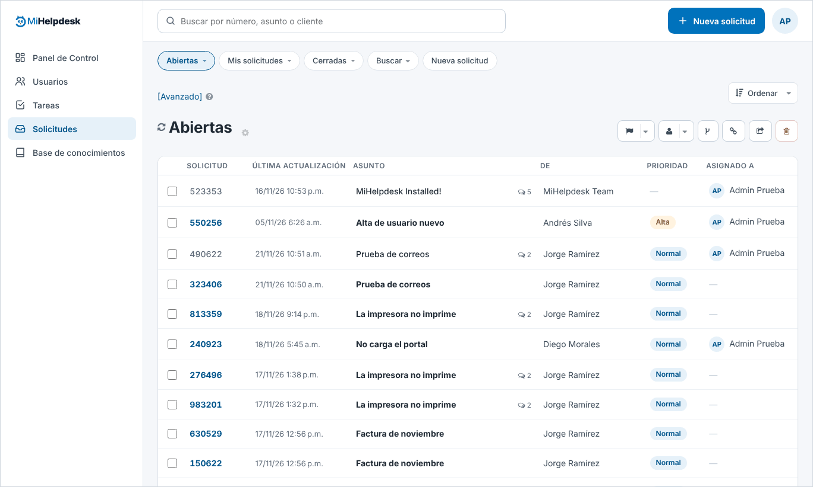
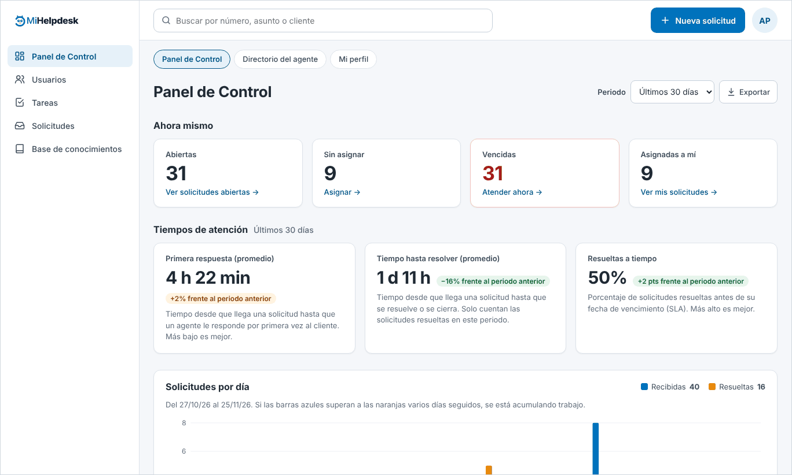
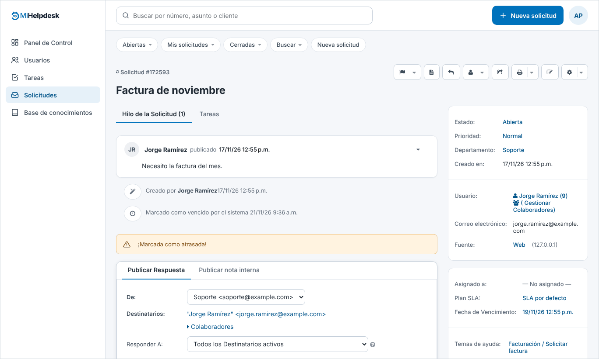
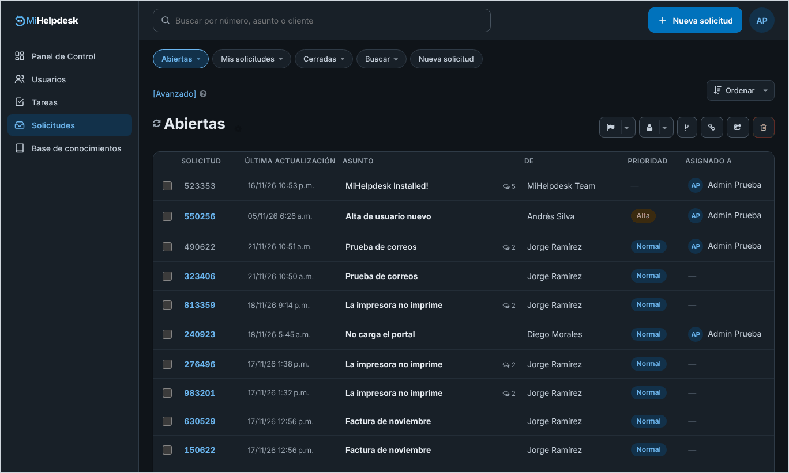
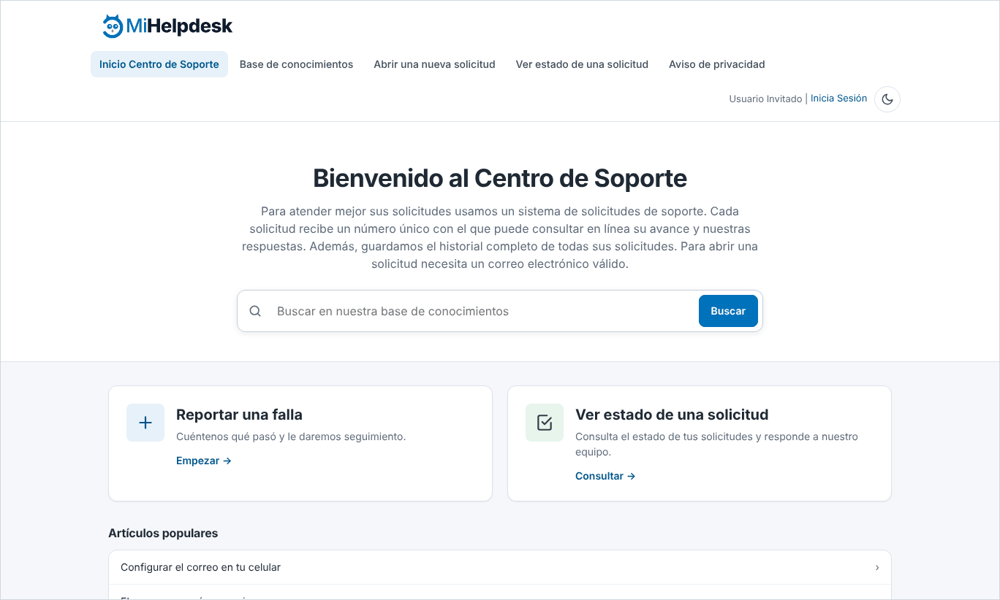
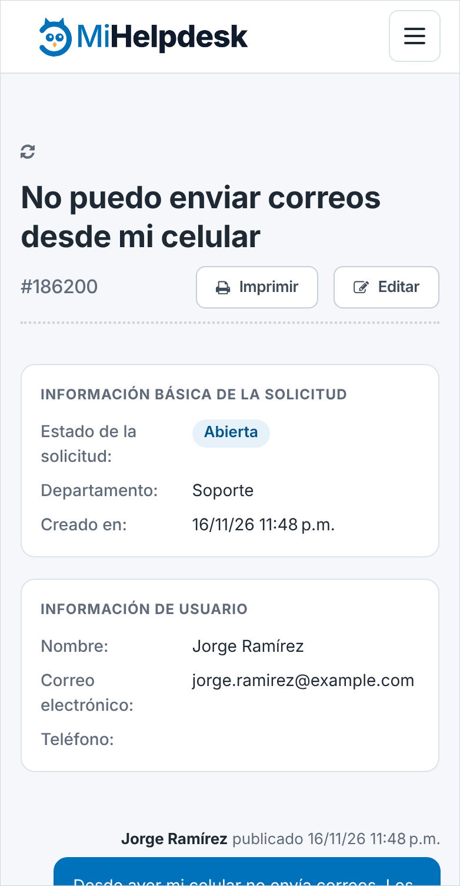

  <picture>
    <source media="(prefers-color-scheme: dark)" srcset="assets/mihelpdesk/marca/mihelpdesk-logo-oscuro.png">
    
  </picture>

  <b>Mesa de ayuda libre, en español, lista para tu equipo de soporte.</b> 
  Basada en osTicket · Licencia GNU GPL v2

  
  
  
  

  <a href="#qué-incluye">Qué incluye</a> ·
  <a href="#instalación">Instalación</a> ·
  <a href="MIGRAR-DESDE-OSTICKET.md">Migrar desde osTicket</a> ·
  <a href="SOPORTE.md">Soporte profesional</a> ·
  <a href="NOTICE.md">Cambios respecto a osTicket</a>

  

> **MiHelpdesk** es un sistema de tickets de soporte de código abierto,
> **basado en el proyecto [osTicket](https://osticket.com)** distribuido bajo la
> **Licencia Pública General de GNU, versión 2 (GPLv2)**.
>
> MiHelpdesk es un proyecto independiente. **No está afiliado, patrocinado
> ni respaldado por Enhancesoft, LLC ni por el proyecto osTicket.**
> "osTicket" es una marca de Enhancesoft, LLC y aquí se menciona para
> indicar el origen del software.

Qué es
------
MiHelpdesk integra en una sola interfaz web las solicitudes que llegan por
correo, teléfono y formularios web. Permite organizar, asignar, dar
seguimiento y archivar los tickets de soporte.

  1. Los usuarios crean tickets desde el portal web, por correo o por teléfono.
  2. Los tickets se guardan y se asignan a agentes.
  3. Los agentes ayudan a resolver cada caso.

Qué incluye
-----------
Todo lo que hace osTicket, más una capa propia que no toca el código
original y se puede desactivar:

  * **Interfaz nueva** para agentes y clientes, con **modo claro y oscuro**.
  * **Funciona en celular y tableta**: menú lateral plegable, tablas que se
    desplazan y formularios que se ajustan a la pantalla.
  * **Marca de cada empresa**: logo para fondo claro y oscuro, y un color de
    marca que se aplica a botones, enlaces y PDF.
  * **Panel de control** con solicitudes abiertas, vencidas, tiempos de
    respuesta y de resolución, y gráfica por día.
  * **Editor de respuestas nuevo**, con imágenes, tablas, enlaces y respuestas
    predefinidas.
  * **PDF de solicitudes y tareas** rediseñados: resumen, tiempos, datos del
    formulario y un código QR que lleva a la solicitud.
  * **Español revisado** en toda la interfaz, el instalador y los correos.
  * **Instalador y actualizador renovados**, con la lista de requisitos y
    los comandos que hay que correr.
  * **Accesible**: revisado contra WCAG 2.1 nivel AA.

<table>
  <tr>
    <td width="50%"> Panel de control</td>
    <td width="50%"> Vista de una solicitud</td>
  </tr>
  <tr>
    <td width="50%"> Modo oscuro</td>
    <td width="50%"> Portal de clientes</td>
  </tr>
</table>

   
  Portal de clientes en el celular

Licencia y libertades
---------------------
MiHelpdesk es **software libre**. Puedes usarlo, estudiarlo, modificarlo y
redistribuirlo bajo los términos de GPLv2 (ver [LICENSE.txt](LICENSE.txt)).
En particular:

  * El código fuente completo, incluidas todas las modificaciones de este
    fork, está disponible en este repositorio.
  * Si redistribuyes MiHelpdesk o una versión modificada, debes hacerlo bajo
    la misma licencia GPLv2 y entregar también el código fuente.
  * El software se ofrece **SIN NINGUNA GARANTÍA**.

Los cambios hechos en este fork respecto a osTicket están documentados en
[NOTICE.md](NOTICE.md).

Soporte profesional
-------------------
El software es gratuito. De forma opcional se ofrecen **servicios de pago**:
instalación, configuración, personalización, alojamiento y soporte técnico
con tiempos de respuesta garantizados. Ver [SOPORTE.md](SOPORTE.md).

Contratar soporte no cambia la licencia del software ni limita tus derechos
bajo GPLv2.

Requisitos
----------
  * Servidor HTTP: Apache o Microsoft® IIS
  * PHP 8.2 – 8.5 (se recomienda 8.4 o 8.5)
  * Extensión mysqli de PHP
  * MySQL 5.5 o superior (o MariaDB)

### Navegadores
  * Chrome, Edge u otro basado en Chromium 110 o posterior
  * Firefox 121 o posterior
  * Safari 15.4 o posterior (Mac, iPhone y iPad)

### Recomendado
  * Extensiones de PHP: ctype, fileinfo, gd, gettext, iconv, intl,
    json, mbstring, Zend OPcache, phar, xml, xml-dom y zip
  * Módulo APCu habilitado y configurado

Instalación
-----------
Clona el repositorio y despliega el código en la carpeta pública de tu
servidor web:

    git clone https://github.com/varreaga/MyosTicket
    cd MyosTicket
    php manage.php deploy --setup /var/www/htdocs/mihelpdesk/

Después abre la URL en el navegador y sigue el instalador. Al terminar,
borra la carpeta `setup/` del servidor.

Para desplegar actualizaciones:

    git pull
    php manage.php deploy -v /var/www/htdocs/mihelpdesk/

### Compresión (recomendado)
El editor de texto pesa unos 520 KB; comprimido, unos 160 KB. Se descarga
una sola vez por navegador, pero conviene que el servidor lo mande
comprimido. En Apache, con `mod_deflate` activo (`a2enmod deflate` en
Debian), agrega al sitio:

    <IfModule mod_deflate.c>
        AddOutputFilterByType DEFLATE text/html text/css text/javascript application/javascript application/json
    </IfModule>

En nginx: `gzip on; gzip_types text/css application/javascript application/json;`

Pasar de osTicket a MiHelpdesk
------------------------------
MiHelpdesk usa la misma base de datos que osTicket: se cambia el código y
se conservan las solicitudes, los adjuntos, los agentes y la configuración.
Probado desde osTicket 1.17 y 1.18. Los pasos, con respaldo y cómo volver
atrás, están en [MIGRAR-DESDE-OSTICKET.md](MIGRAR-DESDE-OSTICKET.md).

Cambiar el nombre o el logo
---------------------------
El logo de MiHelpdesk es el **búho copyleft**: el cuerpo del búho es la C
invertida del símbolo copyleft. Los archivos y su significado están en
[assets/mihelpdesk/marca/](assets/mihelpdesk/marca/README.md).

Cada empresa puede subir su propio logo (para fondo claro y oscuro) y su
color de marca desde el panel de administración; con eso se reemplaza el de
fábrica en el portal, el panel, los correos y los PDF.

El nombre visible del producto está definido en un solo lugar
(`APP_NAME` en `bootstrap.php`). Para cambiarlo en todo el proyecto, ver
[BRANDING.md](BRANDING.md).

Tema visual
-----------
El aspecto de la interfaz se personaliza en `assets/mihelpdesk/`, una capa
de estilos propia que no modifica el CSS original. Ver
[assets/mihelpdesk/README.md](assets/mihelpdesk/README.md).

Accesibilidad
-------------
El portal y el panel se revisan con axe-core contra WCAG 2.1 nivel AA
(81 páginas, en claro y oscuro, en escritorio, tableta y celular): todos
los campos tienen nombre para lectores de pantalla, el foco del teclado
se ve en todo lo que se puede enfocar, hay un enlace «Saltar al
contenido» y el color de marca se ajusta solo para que el texto de los
botones tenga contraste suficiente.

Traducciones
------------
La interfaz es traducible y es compatible con los paquetes de idioma de
osTicket. En los títulos, el pie de página y el instalador, los textos
traducidos que contienen la marca original se muestran con el nombre de
MiHelpdesk (ver la función `brand()` en `bootstrap.php`).

Créditos
--------
MiHelpdesk se basa en **osTicket**, creado por Peter Rotich y desarrollado
por Enhancesoft y su comunidad. Se conservan todos los avisos de copyright
originales de los archivos fuente.

El proyecto incluye, además, estas bibliotecas de código abierto, cada una
con su propia licencia:

  * [Font-Awesome](https://fontawesome.com/)
  * [HTMLawed](https://www.bioinformatics.org/phplabware/internal_utilities/htmLawed)
  * [jQuery dropdown](https://labs.abeautifulsite.net/jquery-dropdown/) (proyecto eliminado)
  * [jsTimezoneDetect](https://pellepim.bitbucket.org/jstz/)
  * [laminas-mail](https://github.com/laminas/laminas-mail)
  * [mPDF](https://github.com/mpdf/mpdf)
  * [PasswordHash](https://www.openwall.com/phpass/)
  * [PEAR](https://pear.php.net/package/PEAR)
  * [PEAR/Auth_SASL](https://pear.php.net/package/Auth_SASL)
  * [PEAR/Mail](https://pear.php.net/package/mail)
  * [PEAR/Net_SMTP](https://pear.php.net/package/Net_SMTP)
  * [PEAR/Net_Socket](https://pear.php.net/package/Net_Socket)
  * [PEAR/Serivces_JSON](https://pear.php.net/package/Services_JSON)
  * [php-gettext](https://launchpad.net/php-gettext/)
  * [phpseclib](https://phpseclib.sourceforge.net/)
  * [Spyc](https://github.com/mustangostang/spyc)
