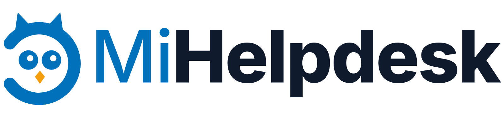
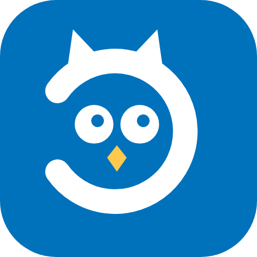

  <picture>
    <source media="(prefers-color-scheme: dark)" srcset="mihelpdesk-logo-oscuro.png">
    
  </picture>

  
  &nbsp;&nbsp;
  
  &nbsp;&nbsp;
  

Logo de MiHelpdesk
==================

El símbolo es el **búho copyleft**. El cuerpo del búho es una C invertida,
la misma del símbolo copyleft. Cada parte tiene un significado:

* **Búho:** conocimiento y atención. Es la base de conocimientos y el
  soporte técnico que encuentra el problema.
* **C invertida (copyleft):** la licencia GNU GPL v2. El software es libre
  y sigue siéndolo aunque se modifique.
* **Pico naranja:** el único acento de color. Es la voz que responde.

El símbolo es original. No usa la cabeza de ñu de GNU ni ninguna otra
marca: aquella pertenece a la Free Software Foundation y usarla haría
parecer que nos respaldan.

Archivos
--------

| Archivo | Uso |
|---|---|
| `mihelpdesk-logo.svg` / `.png` | Logo horizontal para fondos claros |
| `mihelpdesk-logo-oscuro.svg` / `.png` | Logo horizontal para fondos oscuros |
| `mihelpdesk-logo-gris.svg` | Una sola tinta: impresión, pies de página, "powered by" |
| `mihelpdesk-simbolo.svg`, `-512.png` | Solo el búho, en fondos claros |
| `mihelpdesk-simbolo-oscuro.svg`, `-512.png` | Solo el búho, en fondos oscuros |
| `mihelpdesk-simbolo-blanco.svg` | Búho blanco sobre el azul de la marca |
| `mihelpdesk-icono-app.svg`, `-512.png`, `-180.png` | Ícono de app y acceso directo (180 px: iPhone) |

Los SVG son la fuente. El texto está convertido a trazos, así que no
necesitan la tipografía instalada.

Copias de estos logos ya colocadas en el sistema (mismo nombre y tamaño
que los originales de osTicket, ver `BRANDING.md`):

* `assets/default/images/logo.png` y `logo-dark.png`: portal de clientes.
* `scp/images/ost-logo.png` y `ost-logo-dark.png`: panel de agentes.
* `setup/images/logo.png`: instalador original (sin tema).
* `include/fpdf/print-logo.png`: PDF al imprimir solicitudes.
* `scp/images/osticket-grey.png` y `assets/default/images/poweredby.png`:
  versiones pequeñas en gris.
* `images/favicon.png` e `images/oscar-favicon-*.png`: ícono del navegador.
* `include/i18n/en_US/file.yaml`: imagen del pie de los correos.

Cada empresa que use MiHelpdesk puede poner su propio logo en
**Administración › Configuración › Personalización**. Estos son los logos
de fábrica.

Colores
-------

| Nombre | Hex | Uso |
|---|---|---|
| Azul MiHelpdesk | `#0072bc` | Búho y "Mi" en fondos claros |
| Azul claro | `#4fb0ee` | Búho y "Mi" en fondos oscuros |
| Tinta | `#0f1b2d` | "Helpdesk" en fondos claros; fondo oscuro |
| Naranja | `#f59e0b` | Pico (sobre fondo azul: `#ffc94d`) |

Tipografía
----------

**Inter** (licencia SIL Open Font License 1.1): "Mi" en peso 500 y
"Helpdesk" en peso 800, con espaciado de −2 %.

Reglas de uso
-------------

* **Espacio libre:** alrededor del logo, deje al menos la altura de un ojo
  del búho.
* **Tamaño mínimo:** el logo horizontal, 100 px de ancho en pantalla o
  25 mm impreso. El símbolo solo, 16 px.
* **No:** cambiar los colores fuera de esta tabla, estirar o girar el
  logo, separar "Mi" de "Helpdesk", ni poner el logo claro sobre fondo
  oscuro (para eso está la versión oscura).
